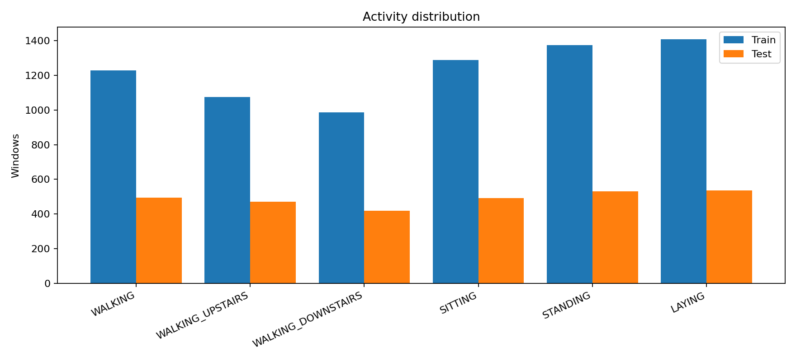
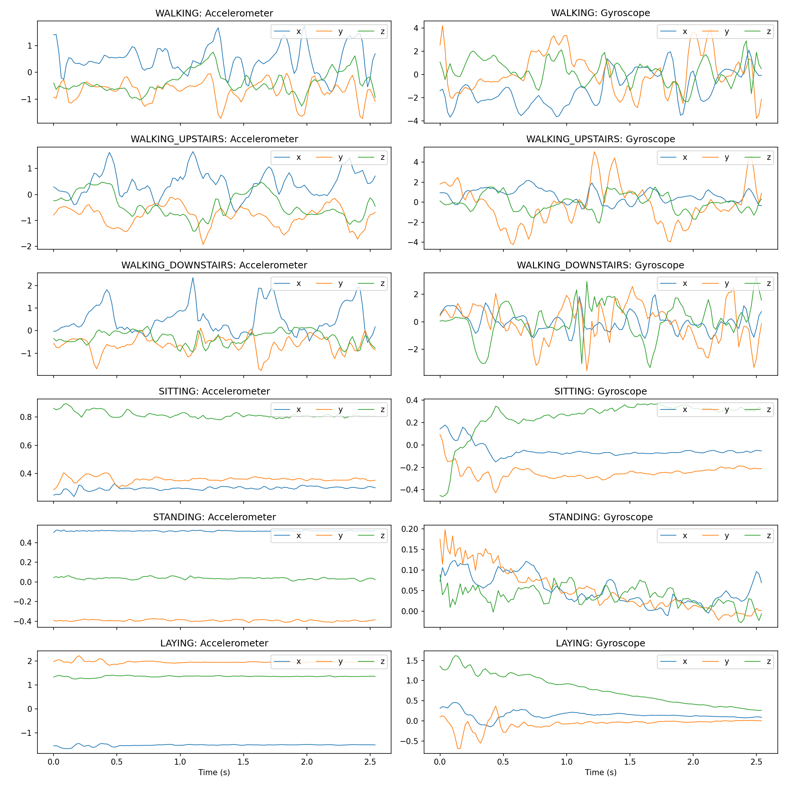
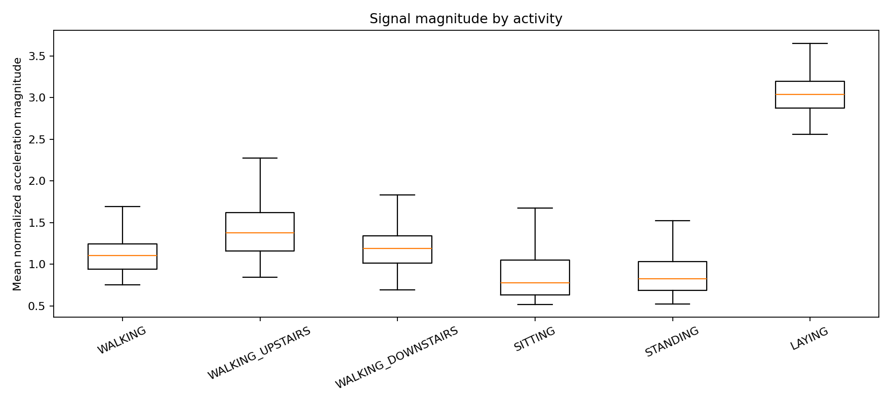

# Classical Models and Evaluation — Dhairya Dabi

## SVM and Random Forest

The classical baselines use the project’s subject-separated UCI HAR training and test split. Each 128-sample, six-channel window is flattened into a feature vector for scikit-learn. Hyperparameters are selected with three-fold subject-grouped cross-validation on the training split only; the held-out test split is used once for final reporting. The SVM search compares linear and RBF kernels with `C` values 0.1, 1, and 10. The Random Forest uses 300 trees and searches `max_features` (`sqrt` or 0.5) and `min_samples_leaf` (1 or 2). The selected settings and cross-validation accuracy are recorded in `results/{svm,rf}_best_params.json`.

## Shared evaluation and feature importance

Both models are saved under `models/` and scored through the same evaluator used by the team. Each metrics JSON includes accuracy, macro and weighted precision/recall/F1, class labels, sample count, confusion matrix, training time, and per-sample inference time. This consistent structure lets `src/compare.py` combine model results without manual reformatting. For the Random Forest, built-in feature importances are summed over the 128 time positions for each of the six sensor channels. The resulting channel ranking is saved to `results/rf_feature_importance.csv`; it describes model reliance, not causal importance.

## Results and comparison

Run `python src/evaluate.py --train-classical` after `src/data.py` has prepared the processed arrays. Then run `python src/compare.py` after the model metrics are available. The comparison script writes `results/comparison.csv` and `results/comparison_metrics.png` for the leaderboard.

**Final test results:** SVM accuracy **88.46%**, macro-F1 **0.883**; Random Forest accuracy **83.81%**, macro-F1 **0.836**. The SVM selected an RBF kernel with `C=10` (grouped CV accuracy 93.68%); the Random Forest selected `max_features=sqrt`, `min_samples_leaf=1` (grouped CV accuracy 95.61%). On this test split, SVM gave the stronger overall score, while RF inference was faster (about 0.17 ms/sample versus 22.55 ms/sample for SVM on this run). These measurements are specific to this machine and run.

The SVM is trained with `probability=False`. The Streamlit app turns its decision scores into softmax-normalized display scores; these are useful for showing relative class confidence but are **not calibrated probabilities**. The app labels them as estimates.

## Exploratory Data Analysis

The official subject-separated UCI HAR dataset contains six activities with 128-sample windows from six accelerometer and gyroscope channels. The class-count plot shows the train/test distribution; the signal plot illustrates the different axis patterns in static and dynamic movements. The magnitude boxplot summarizes per-window acceleration magnitude after train-fitted standardization. These visualizations are descriptive; they do not imply causal feature importance.

